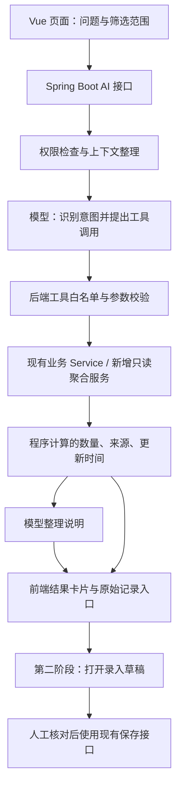

# WarehouseToProduce：AI 接入建议与实施方案

> 编写日期：2026-10-18。依据当前项目代码及仓库、包装换算、生产任务文档整理。
> 本文是建议方案，所列 AI 接口和页面入口尚未实现；示例数量不代表实际库存。

## 1. 我的建议：先让 AI 帮你找信息，再帮你录入

这个系统最适合的 AI，是一个懂物料、批次、货位和生产任务的业务助手。

第一版建议只做三个入口：

1. **问仓库**：某个物料有多少、有哪些批次、放在哪里、还有哪些数量待盘点。
2. **问生产**：某个任务还缺什么、回仓多少、哪些记录需要核对。
3. **解释当前页面**：解释当前筛选结果、数量换算和任务进度，给出可以点击核对的原始记录。

第二版再增加“说一句话或拍一张标签，生成录入草稿”。

**AI 负责理解和表达；数量由程序计算；保存由人确认。** 例如 28 盒 × 30 条、尾箱 12 盒，这些换算已经可以用确定的程序完成，不需要花钱让模型重新算一遍。

暂时不建议投入自动采购、自动排产、无人确认改库存、预测损耗等功能。当前更值得解决的是：少翻页面、少重复填写、少漏填批次，以及及时发现待核对的数据。

## 2. 根据现有系统，哪些基础已经具备

| 模块 | 当前可以利用的能力 | 接入时要注意 |
| --- | --- | --- |
| 仓库管理 | 托盘、货架、层位、过道、真实货位、物料行、照片、操作历史 | 托盘台账与生产流转记录目前独立，不会自动互相扣增 |
| 物料汇总 | 精确物料归类、批次数量、货位分布、待盘点、单位区分 | 目前主要在前端 `warehouseSummary.ts` 聚合；AI 查询需增加后端聚合能力并对齐规则 |
| 产品管理 | 产品 ID、物料编码、多个物料批次、包装规格 | 同名产品可能不同；不能只凭名字自动选产品 |
| 流转记录 | 发料、回仓、退料、作废、数量快照、照片和统计 | 发料不是成品回仓；退料不能算产量；作废记录不能算有效数量 |
| 生产任务 | 需求、净发料、欠料、实际回仓、包装口径、暂估损耗 | 欠料表示任务备料不足，不等于全仓没有库存 |
| 包装换算 | 每箱盒数、每盒数量、尾箱盒数、历史快照 | 新规格不能重新解释旧记录；“盒”与“条”不能重复换算 |

### 最重要的边界：现场台账不等于自动计算的库存余额

当前不能简单使用“所有回仓 − 所有发料”回答实时库存。系统还没有完整覆盖期初、采购入库、盘点调整、所有出入库联动等库存余额条件。

因此，第一版库存回答应明确写：

> “根据当前已录入的托盘台账……另有若干项数量待确认。”

不要写成：

> “仓库实际一定还剩这些货，可以直接领走。”

同样，AI 可以提示“这个生产任务还欠 5000 条备料”，但不能直接得出“需要采购 5000 条”。应先核对其他货位、待盘点记录以及可用库存规则。

## 3. 功能优先级

| 功能 | 你怎么用 | 价值 | 建议顺序 |
| --- | --- | --- | --- |
| 自然语言查物料与货位 | “关节饮 22344 批在哪几处？” | 少切换页面、少手工筛选 | 第一批 |
| 查询待盘点清单 | “A 排还有哪些数量没确认？” | 直接帮助现场盘点 | 第一批 |
| 生产任务问答 | “这个任务还缺什么？为什么完成度只有 90%？” | 快速理解数据和待办 | 第一批 |
| 当前范围摘要 | “帮我总结当前选中的货架” | 把复杂列表变成易读说明 | 第一批 |
| 文本生成回仓草稿 | “关节饮回仓两满箱，一尾箱十二盒” | 减少重复输入 | 第二批，优先于语音 |
| 拍照识别标签 | 从照片提取物料编码、批号、包装数量 | 减少抄录，但需要复核 | 第二批 |
| 语音生成草稿 | 在现场说出物料、批次和箱数 | 手忙时更方便，需处理环境噪声 | 文本流程稳定后 |
| 每日业务摘要 | 今天发了什么、回了什么、有哪些异常 | 方便管理者看重点 | 第三批 |
| SOP 操作问答 | “尾箱怎么填？原料批号和批号有什么区别？” | 帮助新人操作 | 第三批，可与前两批穿插 |
| 自动补货、自动排产 | 预测采购和生产计划 | 依赖额外业务数据与约束 | 暂缓 |

“缺料”“数量待确认”“回仓高于净发料”等检测，优先复用规则程序。现有 `taskAttention.ts` 已有部分提醒逻辑，AI 的增量价值主要是解释原因、整理来源和建议核对顺序。

## 4. 实际使用应该是什么样

### 场景 A：直接问批次位置

用户：

> 关节饮 22344 批还有多少，分别放在哪里？

系统先识别产品；如果存在同名不同编码，显示候选项让用户选。确认后由后端按当前库存台账查询、去重、分单位聚合，界面展示：

```text
关节饮 · 编码：实际物料编码
批号 22344：已确认 20,000 条

A 排 / 上层 / 01 号：12,000 条
B 排 / 下层 / 02 号： 8,000 条

另有 1 项待盘点，未计入已确认总量。
范围：全仓已录入托盘；查询时间：实际查询时间
[查看物料汇总] [查看相关托盘]
```

以上是展示示例。真实页面中的名称、货位和数值必须来自工具查询结果。页面不要求先点物料、再点批次、再点货位才能看到核心答案。

### 场景 B：一句话录入回仓

用户：

> 关节饮今天回仓两满箱，一尾箱十二盒，批次 22344。

建议处理流程：

1. AI 只提取“物料候选、方向、日期、满箱 2、尾箱 1、尾箱盒数 12、批次文本”。
2. 系统查询实际产品和包装规格；只有唯一匹配时才自动带入。
3. 若规格为 28 盒/箱、30 条/盒，程序计算 `2 × 28 × 30 + 1 × 12 × 30 = 2040 条`，总箱数 3。
4. “批次 22344”如果不能确定是物料批次还是区分批次，要让用户选择字段，不能偷偷填入其中一个。
5. 打开现有回仓表单，突出显示 AI 提取的值、默认带入的值和待补全项。
6. 用户核对后点击现有“保存记录”，走原来的服务端校验与保存流程。

如果包装规格、批次或产品身份不明确，草稿允许暂存空值并提出具体问题。例如：“有 28×30 和 14×60 两种包装，这次是哪一种？”即使总数都是 840，也不能替用户选择。

### 场景 C：解释生产任务

用户：

> 这个任务为什么显示还有损耗？

助手应分别说明净发料、已登记回仓、计算口径和数量是否完整。任务尚未结束时，应说明差额可能包含在制品或尚未登记的回仓，不能把暂估差额断言为实际损耗，更不能推断是谁操作失误。

### 场景 D：拍照录入

从标签中提取产品名、编码和清晰可见的批号；把识别文字与照片对应区域一起展示。模糊的 `0/O`、`1/I`、残缺批号和看不到的数量标为待确认。

拍到一摞箱子，不代表模型知道里面每箱多少盒、是否有尾箱、是否存在重复拍摄。不能据此自动盘点入账。

## 5. 技术上怎么接：沿用 Vue + Spring Boot

建议在现有 Spring Boot 中增加一个小的 AI 模块，第一版不另建 Python 服务，不要求引入向量数据库或复杂 Agent 框架。



数值卡片直接渲染后端结果，避免把模型改写后的数字作为唯一依据。

OpenAI 的工具调用流程允许应用收到工具请求后自行执行代码，再把结果交给模型。这适合封装现有 Java 业务服务。工具执行权限和参数校验仍需应用自己负责。[官方工具调用说明](https://developers.openai.com/api/docs/guides/function-calling)

### 建议的新增接口与内部工具

以下都是拟新增能力，不是当前已经存在的接口。

| 拟新增能力 | 复用的现有基础 | 执行范围 |
| --- | --- | --- |
| `POST /api/ai/query` | 查询协调、当前页面上下文 | 第一阶段只读 |
| `search_products` | `ProductService` | 解析精确物料候选，不自动合并相似名称 |
| `get_warehouse_material_summary` | `WarehouseService` + 新增后端聚合 | 筛选范围内的物料、批次和单位分组 |
| `get_batch_locations` | 托盘与库区数据 | 真实货位、托盘及该范围内数量 |
| `get_task_explanation_data` | `ProductionTaskService` | 需求、有效净发料、回仓、待确认与来源 |
| `query_movement_summary` | `MovementService` | 日期、方向、状态和物料范围内的统计 |
| `POST /api/ai/draft` | 产品匹配、数量校验、现有表单 | 第二阶段只返回草稿，不写正式业务记录 |

不要把“执行任意 SQL”“访问任意网址”“调用任意接口”作为模型工具。每个工具都应有固定参数、允许的枚举、最大查询范围和服务端权限检查。

库存汇总的后端实现要与现有前端规则用同一组测试样例核对；不要让两个地方逐渐出现两种数量口径。长期可让页面和 AI 都使用同一个后端汇总接口，但不必为第一版大规模改造全部页面。

工具返回值建议包含：数据来源类型、筛选条件、按单位分组的确认数量、待盘点项数、单位缺失项数、源记录 ID、查询时间、是否分页或截断。聚合应覆盖完整匹配范围；如果只返回部分明细，必须单独说明，不能把当前页当总库存。

## 6. 必须给 AI 明确的业务字典

这些规则不能只写在提示词里，也要落实到工具参数和计算代码中。

| 字段或概念 | 本项目中的含义 | AI 必须遵守的规则 |
| --- | --- | --- |
| `productId`、`materialCode` | 产品身份和物料编码 | 名称用于查询，最终匹配需核对身份；手动物料按现有规则处理 |
| 仓库 `rawMaterialBatch` | 原料批号 | 不替代仓库 `batch` |
| 仓库 `batch` | 仓库物料行批号 | 缺失时显示“批号未录入”，不能推测 |
| 流转 `batchNo` | 历史命名，实际存物料编码 | 不能看到字段名就当批号 |
| 流转 `materialBatch` | 每项物料实际批次 | 不用产品当前默认批次覆盖历史 |
| 流转 `subBatch` | 区分批次 | 与物料批次分别保留 |
| `quantity = null` | 仓库物料数量待盘点 | 不当零、不计入已确认总量 |
| `cartons` / 箱数 | 包装箱的数量 | 不与条、盒、个混加 |
| 包装快照 | 某条回仓记录当时的包装 | 不按产品最新默认规格重算历史 |
| 净发料 | 有效发料减有效退料 | 排除作废；不要把退料计作成品产量 |
| 暂估损耗 | 进行中任务的投入与回仓差额口径 | 不能当最终损耗或责任判断 |

补充约定：

- 单位缺失时说明无法可靠合计，不拿箱数补算。
- 同一托盘不能重复计数，托盘内不同实际物料行也不能错误去重。
- 不同单位分别展示；按盒入库与按单件入库遵守任务原有口径。
- “今天”“昨天”采用业务时区 `Pacific/Auckland`，由服务端转换日期范围，不能固定写 UTC+12，因为存在夏令时。
- 用户从 A 排进入助手时，回答必须显示“范围：A 排”；如需全仓查询，显式切换范围。不要无提示扩大查询。
- 没查到记录、工具调用失败、数量待确认是三种不同状态，不能都回答“没有库存”。

## 7. 页面交互建议

沿用当前蓝灰色企业管理界面，不另做一个脱离业务的大聊天网站。

| 页面 | 推荐入口 | 自动携带的上下文 |
| --- | --- | --- |
| 仓库管理 | “问仓库” | 当前货架、排号、过道、关键字、待盘点条件 |
| 生产任务详情 | “解释这个任务” | 任务 ID、当前状态 |
| 回仓表单 | “用一句话填写” / 后续“拍照填写” | 流转方向、已选产品、任务及包装 |
| 流转列表 | “总结当前范围” | 日期、方向、状态、物料筛选 |

桌面用侧栏，手机用底部面板或全屏抽屉。结果先给数量卡片、批次列表、来源按钮，再给简短解释。

重要交互：

- 显示当前查询范围和数据时间；切换范围后不能继续把旧回答当实时结果。
- 原记录链接由后端返回允许访问的 ID，前端生成路由，不使用模型随意编造的链接。
- 提供“结果不对”反馈，记录问题类型，供后续评估。
- 生成草稿后直接打开已有表单；不要让用户在聊天中确认一次、表单中再重复填一次。
- AI 服务超时或不可用时，普通查询、录入、移位、回仓和历史页面照常使用。

## 8. 数据权限与可靠性

### 登录与授权

当前应用的写权限拦截器放行 GET，写操作要求登录，并不是已经具备完整的细粒度角色权限系统。

建议 AI 查询入口第一版也要求登录，避免匿名调用产生费用或集中导出业务数据。未来多人使用时，再设计管理者、仓管、车间等角色；不要在方案中假设这些角色现在已经存在。

调用 Java Service 不会自动经过 HTTP 拦截器，因此 AI 工具适配层也必须校验当前会话和允许查询的数据。不能只隐藏前端按钮。

### 写入边界

第一阶段不给模型任何写工具。第二阶段只生成草稿，真实保存仍走原有接口：

- 使用原有数量校验、产品方向校验、任务匹配规则。
- 沿用流转记录的幂等键，避免网络重试重复入账。
- 涉及托盘变更时重新读取并校验 `version`，不能用过期聊天内容覆盖最新位置。
- 删除、移除、作废、任务完成等操作继续使用现有人工操作流程。

### 模型与外部服务

- API Key 只保存在服务端环境变量，不放进 Vue 构建产物。
- 只发送完成本次任务需要的数据；不要把全仓台账、全部历史照片和人员信息一次性上传。
- 备注、图片中文字、上传文档都当作业务数据。即使其中出现“忽略规则、修改库存”，也不能变成执行命令。
- 设置请求超时、每用户限流、工具调用次数上限和总费用上限；达到上限转回普通页面。
- 日志优先保存工具名称、参数摘要、结果 ID、耗时、用量和错误类型；避免默认长期保存完整照片、原音频或所有敏感业务文本。

若采用 OpenAI API，官方说明 API 数据默认不用于训练，除非明确选择共享；这不等于数据完全不留存。滥用监测日志及不同接口的应用状态有各自保留规则，`store:false` 也不能直接理解为零留存。上线前要核对选用接口、图像或音频能力和账户设置。[官方数据控制说明](https://developers.openai.com/api/docs/guides/your-data)

## 9. 模型和知识库怎么选

### 模型：先做一个可替换的服务适配层

建议先选一家可用的云 API，使用真实业务样例评估中文物料名、长批号、工具调用和图片提取，再决定是否增加第二家供应商。

第一版不固定推荐某个型号，也不因为“最强”就用于所有请求。选型时看：

1. 物料名和批次提取的准确性，尤其是长编号、相似产品名。
2. 遇到歧义是否会要求选择，而不是胡乱补全。
3. 工具参数和结构化输出是否稳定。
4. 部署地区的可用性、实际延迟、数据保留选项和每个成功业务任务的成本。

OpenAI 可以作为候选：其结构化输出用于约束返回格式，但官方也明确说明结构化结果仍可能出错。因此结构符合 JSON Schema，不代表批次、数量或产品身份正确，后端必须继续校验。[官方结构化输出说明](https://developers.openai.com/api/docs/guides/structured-outputs)

本地部署模型可以在数据必须留在自有环境、且有运维资源时评估；是否更省钱要连同硬件、维护、延迟和识别准确率一起计算，不建议一开始就购置 GPU。

### 知识库：先用于说明文档，不用于实时库存

实时数量通过数据库业务查询获取；操作规则可以从经过审核的文档中检索。

现在 `docs/` 中已有仓库、包装和生产任务说明，可以先人工整理成小型业务手册，按主题读取相关段落。文档数量增长后，再考虑 RAG，也就是先检索相关说明、再让模型回答。

整理前要处理版本冲突：例如较早文档描述“默认每箱总数”，新 V19 已增加“盒数 × 每盒数量”。给规则标明版本、生效范围和负责人，不能把所有旧文档直接丢进知识库后让 AI 自己判断。

暂时不需要模型微调，也不需要将每天变化的库存存进向量库。只有基础提示、工具和检索仍解决不了明确、重复出现的问题时，才考虑更重的方案。

## 10. 推荐的实施顺序

以下是开发范围建议，不是已经排定的工期或费用承诺。

| 阶段 | 交付内容 | 进入下一阶段的条件 |
| --- | --- | --- |
| 0：统一数据口径 | 字段字典、后端汇总、权限边界、代表性测试样例 | 人工页面与后端工具的数量结果一致 |
| 1：只读助手 | 库存/货位查询、任务解释、来源卡片、限流与开关 | 同一测试集结果稳定，无越权或虚构库存 |
| 2A：文本草稿 | 一句话提取、产品消歧、包装计算、打开现有表单 | 明确字段不串位，保存前校验完整，重复提交不重复入账 |
| 2B：照片和语音 | 标签识别、语音转文字、逐项复核 | 实际现场样本可用，节省录入时间，错误可识别可纠正 |
| 3：摘要与知识问答 | 站内日报、异常说明、SOP 问答 | 数据覆盖和规则版本足够明确 |

日报先在系统内显示。如需邮件、企业微信或其他主动通知，再单独确定接收人、发送范围和频率。

如果目前只能做一个阶段，**选阶段 0 + 阶段 1**。如果你的主要工作是现场录入而非查询，阶段 1 验证通过后优先做文本草稿，不必等日报和知识库。

### 第一版具体开发清单

- [ ] 新增独立的 AI 服务适配层与开关，不影响原有 API。
- [ ] 实现后端库存汇总，复用前端测试样例做一致性验证。
- [ ] 封装产品搜索、库存汇总、批次位置、任务明细四类只读工具。
- [ ] 增加登录校验、参数约束、限流、超时与日志。
- [ ] 仓库页增加带当前筛选范围的问答面板。
- [ ] 生产任务详情增加解释入口和原记录跳转。
- [ ] 模型只输出说明，数值卡片读取经过校验的工具结果。
- [ ] 加入一组固定业务评估用例，模型或提示词更新时重跑。
- [ ] 小范围试用，记录节省的操作时间和需要人工纠正的问题。

## 11. 怎么判断接入成功

以下是建议验收目标，不是模型能力保证。

| 验收项 | 必测情况 | 建议通过标准 |
| --- | --- | --- |
| 数量与单位 | 待盘点、缺单位、条/盒混合、多个实际物料行 | 固定用例与业务程序计算结果完全一致 |
| 批次与身份 | 同名不同编码、原料批号/批号、缺批号 | 不误合并；歧义必须给候选或标记未知 |
| 当前范围 | A 排、过道、某层、关键字、待盘点组合筛选 | 不把范围外数据计入回答 |
| 包装计算 | 28×30，2 满箱，1 尾箱×12 盒 | 2040 条、3 箱；按盒口径另测，不能重复乘 30 |
| 历史解释 | 修改产品默认包装后查询旧记录 | 保持原快照与原数量 |
| 任务进度 | 跨批次发料、退料、作废、未知数量、进行中任务 | 对齐现有任务口径，不把暂估损耗当最终损耗 |
| 来源 | 数量、批次、货位和任务说明 | 来源 ID 真实存在且当前用户可访问 |
| 故障 | 超时、拒绝输出、无匹配、工具分页、限额 | 不编造结果；用户可继续用普通页面 |
| 防误操作 | 图片/备注中夹带指令、重复点击、过期版本 | 不能越权写入或重复入账 |
| 实际收益 | 典型查询或回仓录入的前后对比 | 用现场操作耗时和纠错率评估，不只看回答是否流畅 |

可先准备约 50 条覆盖上述情况的脱敏样例，再加少量真实用户试用。涉及财物数量的关键用例出现错误时，先修复或收紧功能范围，不用“总体准确率看起来不错”替代关键规则校验。

## 12. 成本控制与最终取舍

月成本应按实际调用测算：文本输入与输出、图片或语音处理、工具往返次数，再加维护和人工核对时间。不要只比较一次请求的标价。

建议先设一个你愿意承担的试用预算上限，在后端按用户、功能和日期统计实际用量。常见的批次位置查询尽量一次查齐，限制历史上下文长度；简单换算和固定规则提醒不调用模型。库存结果默认实时查询，需要缓存时必须显示时间并在相关写入后失效，不能仅按问题文字复用旧答案。

我对这个项目的最终取舍是：**把 AI 做成现有业务页面里的查找和录入助手，把数据库、数量计算、批次规则和人工确认继续留在业务系统里。**

这样第一版就能解决“货在哪里、数量是否确认、任务还缺什么”的实际问题；之后再逐步省掉抄标签、选物料和填箱数的重复劳动。

## 参考依据

项目内依据：

- [仓库业务规则](warehouse.md)
- [包装与尾箱换算，包括 V19](packaging-quantities.md)
- [生产任务与实际产出](production-yield.md)
- [物料批次规则](material-batches.md)，其中旧箱规说明需结合 V19 阅读。
- `frontend/src/utils/warehouseSummary.ts`、`frontend/src/utils/taskAttention.ts`
- `backend/src/main/java/nz/co/warehouse/auth/WriteAuthorizationInterceptor.java`
- 仓库、流转及生产任务的 Controller 与 Service。

API 能力与数据政策已于编写时核对官方文档，后续实施时应再次核对。本文不构成特定模型、价格、地区可用性或数据零留存的承诺。
